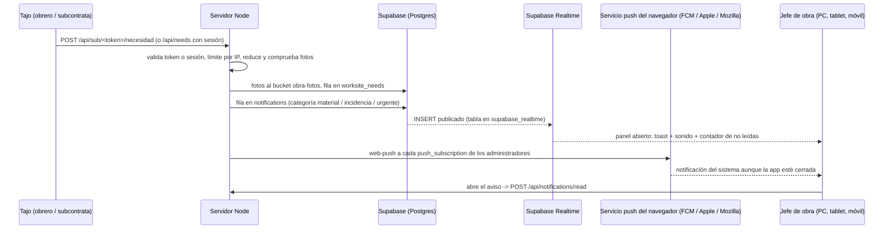

# Avisos en tiempo real, necesidades de obra y pedidos de material

Diseño para ObraMaster con su stack real: React + Vite (PWA), servidor Node sin framework (`backend/server.js`), Supabase (Auth, Postgres, Realtime, Storage) y Render. No hay Next.js ni Prisma: el esquema va en SQL (`supabase_schema_notificaciones.sql`) y se ejecuta en Supabase > SQL Editor.

## 1. Piezas

| Pieza | Dónde |
|---|---|
| Tablas `notifications`, `push_subscriptions`, `worksite_needs`, `material_orders`, `subcontractor_tokens`, `site_reports`, `suppliers` + bucket `obra-fotos` | `supabase_schema_notificaciones.sql` |
| API de avisos, necesidades, pedidos, proveedores, partes y enlaces | `backend/notificaciones.js` |
| Plantilla del correo al proveedor | `backend/supplierEmail.js` |
| Web Push (envío y suscripciones) | `backend/webPush.js`, `public/sw.js`, `src/services/pushService.js` |
| Avisos en tiempo real (Supabase Realtime), toasts con sonido y campana con contador | `src/context/NotificationsContext.jsx`, `TopHeader.jsx` |
| Menú "Avisos y Pedidos": avisos, necesidades y pedidos, partes, enlaces y proveedores | `src/components/Avisos/` |
| Página de la subcontrata `/sub/<token>` | `src/components/PortalSubcontrata/SubcontrataPortal.jsx` |
| Botón "Pedir Material" del Portal del Obrero | `src/components/PortalObrero/PedirMaterialModal.jsx` |
| Respuesta por correo (inbound) | Pendiente, opcional (fase 3) |

## 2. Ciclo de vida de un aviso



Paso a paso:

1. **Emisión.** Desde el tajo llega una acción: el obrero con sesión (`POST /api/needs`) o la subcontrata por su enlace (`POST /api/sub/<token>/terminado|necesidad`). Nunca se escribe directamente desde el navegador en la base de datos.
2. **Validación en el servidor.** Se comprueba la sesión (Supabase Auth) o la huella SHA-256 del token, que no esté anulado ni caducado, el límite de peticiones por IP y que las fotos sean JPG/PNG/WEBP de verdad (bytes mágicos), máximo 3 y 8 MB.
3. **Persistencia.** Fotos al bucket privado `obra-fotos`; la necesidad en `worksite_needs` o el parte en `site_reports`; y siempre una fila en `notifications` con `category` (urgente, aviso, material, incidencia), `origin`, `obra_id` y `ref_table`/`ref_id` para abrir el detalle.
4. **Tiempo real (panel abierto).** La tabla `notifications` está en la publicación `supabase_realtime`. El panel se suscribe con `supabase.channel('avisos').on('postgres_changes', { event: 'INSERT', schema: 'public', table: 'notifications' }, ...)`. RLS hace que solo los administradores reciban los avisos generales. Se muestra un toast y se reutiliza el sonido de `realtimeSyncService.js`.
5. **Push (app cerrada o en segundo plano).** `createNotification()` llama a `sendPushForNotification()`, que envía la notificación a cada suscripción guardada; el navegador la entrega a través de su servicio push y el service worker la muestra.
6. **Lectura.** Al abrirla se marca `read_at`. El centro de notificaciones filtra por obra y por categoría con `GET /api/notifications?unread=1&obra=…&category=…`.

## 3. Web Push en una PWA hecha con Vite

No hace falta Firebase: la Web Push API estándar con claves VAPID funciona en Chrome/Edge/Firefox (escritorio y Android) y en iPhone desde iOS 16.4 **solo si la PWA está instalada** en la pantalla de inicio. FCM solo compensaría con una app nativa.

1. **Claves VAPID.** Se generan una vez (`npx web-push generate-vapid-keys`) y van solo en el servidor (Render y `.env`): `VAPID_PUBLIC_KEY`, `VAPID_PRIVATE_KEY` y `VAPID_SUBJECT` (`mailto:` del administrador). El navegador pide la pública a `GET /api/push/public-key`, así no hace falta recompilar.
2. **Service worker.** `public/sw.js`, registrado en `main.jsx` con `navigator.serviceWorker.register('/sw.js')`. Escucha `push` (muestra `self.registration.showNotification(title, { body, tag, data: { link } })`) y `notificationclick` (enfoca la pestaña abierta o abre `data.link`). El servidor ya sirve los archivos de `public/` copiados a `dist/`.
3. **Suscripción.** Tras pulsar "Activar avisos en este dispositivo" (Avisos y Pedidos) (el permiso solo se puede pedir con un gesto del usuario, y en iOS es obligatorio): `registration.pushManager.subscribe({ userVisibleOnly: true, applicationServerKey })` y `POST /api/push/subscribe` guarda `endpoint`, `p256dh` y `auth` en `push_subscriptions` ligados al usuario.
4. **Envío.** `sendPushForNotification()` (`backend/webPush.js`) usa la librería `web-push`. Si el servicio responde 404/410 la suscripción ha caducado y se borra; otros errores suman `failures`.
5. **Sin duplicados.** Si el panel está abierto y visible, el service worker no muestra la notificación del sistema (comprueba `clients.matchAll()` con `visibilityState === 'visible'`) y deja que salga el toast.

## 4. Necesidades y pedidos a proveedor

```
nueva ──(Generar borrador)──> en_revision ──(Aprobar y enviar)──> pedido_tramitado ──> entregado
   └──────────────(Descartar)──> descartada            (incidencias sin material) ──> resuelto
```

1. **Alta.** La necesidad entra con obra, tajo, categoría, líneas de material (`items`: material, cantidad, unidad), fecha límite y contacto en obra. Si viene de una subcontrata en texto libre, el texto se guarda como primera línea y se corrige en la pantalla de revisión antes de generar el borrador (más adelante, la IA ya integrada podría separar materiales y cantidades).
2. **Borrador.** `POST /api/needs/<id>/order-draft` con `supplier_ids` (uno, o varios para comparar precios) y `kind` (`pedido` o `solicitud_presupuesto`). Crea una fila `material_orders` en estado `borrador` por proveedor con asunto (código de obra, dirección de entrega, URGENTE si procede), tabla de materiales, fecha límite y persona de contacto para la descarga, en HTML y en texto. La necesidad pasa a `en_revision`. No se envía nada, salvo que se pase `send: true`: entonces cada borrador se envía en el acto (botón "Enviar pedido ya", tanto al dar de alta la necesidad como después en su ficha) y la respuesta incluye `errors` con los envíos que fallen.
3. **Revisión.** El administrador edita asunto, cuerpo y destinatario con `PATCH /api/material-orders/<id>`.
4. **Aprobar y enviar.** `POST /api/material-orders/<id>/send` envía con Resend desde el servidor (`backend/emailService.js`; el texto sale de la plantilla de Ajustes > Correos y plantillas) (`RESEND_API_KEY`, sin prefijo `VITE_`), con `reply_to` al correo de la empresa para que el proveedor conteste a la oficina y una clave de idempotencia para no mandar dos veces el mismo pedido. El pedido pasa a `enviado` y la necesidad a `pedido_tramitado`. Si Resend falla, el pedido queda en `error` con el motivo y se puede reintentar.
5. **Proveedores.** Tabla `suppliers` con `categories` (fontanería, electricidad, áridos…) para proponer los habituales de cada partida.

## 5. Subcontratas sin app ni contraseña

**Opción A, enlace mágico (implementada).** Desde Avisos y Pedidos > Enlaces a subcontratas, `POST /api/sub-tokens` crea un token aleatorio de 192 bits (`tk_…`), guarda solo su huella SHA-256 con la subcontrata, la obra y la tarea, y devuelve la URL `https://<app>/sub/tk_…` y un enlace `wa.me` con el mensaje ya escrito para mandarlo por WhatsApp con un toque. La página carga sin login y ofrece dos botones grandes: **Trabajo terminado** (notas y 1–2 fotos) y **Necesidad o incidencia** (categoría, texto, urgente, fotos). Las fotos se reducen en el móvil a 1600 px antes de subirlas.

Seguridad del enlace: caduca (60 días por defecto, configurable), se puede anular (`POST /api/sub-tokens/<id>/revoke`), solo permite crear partes y necesidades de su obra (no ve datos de la empresa ni de otras obras), tiene límite por IP y queda registrado su uso (`last_used_at`, `use_count`). Si un enlace se reenvía a quien no debe, lo peor que puede pasar es un aviso falso, que el jefe de obra revisa antes de actuar.

**Opción B, respuesta por correo.** Viable con el webhook de entrada de Resend o Postmark y una dirección por obra (`obra-42@entrada.tudominio.es`). Requiere dominio propio con registros MX y filtrar spam; se deja para la fase 3 porque las subcontratas usan WhatsApp mucho más que el correo.

**Opción C, PWA ligera.** Para subcontratas fijas basta con darles usuario de rol obrero (ya existe) limitado a sus tajos. Se valorará cuando haya alguna fija.

## 6. Puesta en marcha

1. Supabase > SQL Editor: ejecutar `supabase_schema_notificaciones.sql`.
2. Render y `.env`: `RESEND_API_KEY`, `RESEND_FROM_EMAIL` (con dominio verificado en Resend; pasos en `docs/correo-resend.md`), `PUBLIC_APP_URL=https://obria-crm.onrender.com`, y las tres `VAPID_*` (generadas con `npx web-push generate-vapid-keys`).
3. En la app: Avisos y Pedidos > Proveedores (dar de alta los habituales con su correo y categorías) y pulsar "Activar avisos en este dispositivo" en el PC y en el móvil (en iPhone, con la app instalada en la pantalla de inicio).
4. Probar: Enlaces a subcontratas > crear un enlace, abrirlo en el móvil y mandar una necesidad de material; debe saltar el aviso en el panel y llegar la notificación al móvil. Después: Necesidades y pedidos > Generar borrador > Aprobar y enviar pedido.
